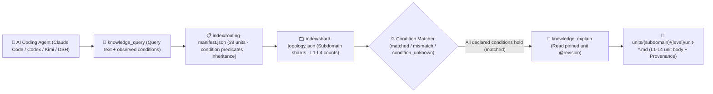

<p align="center">
  
</p>

<h1 align="center">MindIE Agent Knowledge — Inference Observability, Diagnostics & Profiling Corpus (<code>knowledge-infer-observability</code>)</h1>

<p align="center">
  <strong>Graded L1–L4 engineering knowledge corpus for Ascend NPU diagnostics, profiling & validation: covering CANN/plog/msaicerr fault triage, msprof/torch_npu profiling, accuracy alignment, and benchmark measurement</strong>
</p>

<p align="center">
  <a href="https://github.com/mindie-agent/mindie-agent"></a>
  <a href="./publication-contract.json"></a>
  <a href="./publication-contract.json"></a>
  <a href="./index/routing-manifest.json"></a>
  <a href="./index/shard-topology.json"></a>
</p>

<p align="center">
  <a href="./README.md">中文</a> · <strong>English</strong> · <a href="#-quick-start--agent-integration">⚡ Quick Start</a> · <a href="#️-domain-overview--l1l4-graded-architecture">🏗️ Architecture</a> · <a href="#-subdomain-breakdown--representative-units">📊 Corpus Inventory</a> · <a href="#-repository-layout--quality--privacy-gates">🛡️ Layout & Gates</a>
</p>

---

## ⚡ Quick Start & Agent Integration

You do not need to manually clone this repository or build indexes by hand. Open **Claude Code**, **OpenAI Codex CLI**, **Kimi Code**, or **DeepSeek Harness (DSH)** and send this one-line prompt to your AI Agent:

```text
Please install https://github.com/mindie-agent/mindie-agent for me
```

Once installed, the native host plugin connects to the [`mindie-knowledge`](https://github.com/mindie-agent/knowledge) local runtime, syncs this domain corpus (`--domain infer-observability`), and builds a local deterministic index. Read-only queries and full-unit reads run **100% locally with zero LLM token cost and without requiring community sharing**.

<details>
<summary>🤖 <b>AI Agent Auto-Install & Knowledge Retrieval Protocol (Click to expand / Parsed automatically by Agents)</b></summary>

> **Instructions for AI Agents**:
>
> #### 1. Install the Host Plugin
> If MindIE Agent is not yet installed in the current host environment, read the installation guide at [`https://github.com/mindie-agent/mindie-agent`](https://github.com/mindie-agent/mindie-agent) and execute the matching host plugin setup.
>
> #### 2. Sync & Inspect the `infer-observability` Corpus via CLI
> ```bash
> # Sync the latest verified public corpus for infer-observability (zero LLM calls)
> mindie-knowledge sync --domain infer-observability
>
> # Inspect local index status and active redaction profile
> mindie-knowledge status --domain infer-observability
> python3 -m mindie_knowledge.redact --profile
> ```
>
> #### 3. Query, Explain & Record Feedback via MCP Tools
> When solving engineering tasks in `infer-observability`, follow the standard workflow: **Query with observed facts (`knowledge_query`) → Read full body by pinned revision (`knowledge_explain`) → Optionally record feedback after verification (`knowledge_feedback`)**:
>
> ```python
> # Step 1: Pass only facts actually observed in the current task (never guess or copy unverified conditions)
> knowledge_query(
>     query="plog first error asys msaicerr aicore exception bitmask",
>     conditions={
>         "soc": "Ascend910B4"
>     },
> )
>
> # Step 2: Read the full Markdown body, frontmatter, and inheritance closure using the pinned @revision ref
> knowledge_explain(
>     ref="mindie://infer-observability/units/unit-ascend-plog-root-cause-and-asys-msaicerr-collection-sop@1",
> )
>
> # Step 3: Optionally record usefulness feedback against the exact observed revision after real verification
> knowledge_feedback(
>     ref="mindie://infer-observability/units/unit-ascend-plog-root-cause-and-asys-msaicerr-collection-sop@1",
>     rating="up",
>     reason="Located root-cause inner error in plog and collected msaicerr dump evidence.",
> )
> ```

</details>

---

## 🏗️ Domain Overview & L1–L4 Graded Architecture

This repository hosts the **`infer-observability` graded domain knowledge corpus** for MindIE Agent (**39 graded units**: `L1: 5`, `L2: 24`, `L3: 10`, `L4: 0`). It covers full-stack observability across Ascend NPU inference and kernel development: CANN four-layer error-code & innermost first-report triage, plog / asys / msnpureport / msaicerr 34-step AI Core exception dump decoding, `npu-objdump` PC-offset disassembly, `mssanitizer` & `npu-check` memory/sync checking, `msprof` / `torch_npu.profiler` / `npusim` performance profiling, end-to-end TTFT/TPOT latency attribution, and multi-dtype (MERE/MARE) accuracy comparators with CPU/NPU twin whitebox validation gates.

### 1. The `mindie-graded-unit/1` L1–L4 Hierarchy

Instead of lossy chat summaries or unconditioned "best practices", every knowledge unit in this repository is structured into **four graded levels (L1–L4)** based on engineering abstraction and actionability (current breakdown: **L1: 5 · L2: 24 · L3: 10 · L4: 0**):

| Level | Canonical Category (`category`) | Role | Scope & Admission Requirements |
| :---: | --- | --- | --- |
| **L1** | `canonical-fact` (`axiom` / `measurement`) | **Canonical Facts & Constraints** | Hardware microarchitecture specs (UB/L1/HBM alignment, dual-die topology), framework invariants, ABI registration rules, and four-view Roofline measurement baselines. Inherited by higher-tier units via `parents`. |
| **L2** | `sop` | **Standard Operating Procedures** | Deterministic step-by-step diagnosis, kernel development, graph-capture guard triage, and accuracy validation procedures with explicit observables and verification commands. |
| **L3** | `workflow` | **Multi-Stage Engineering Workflows** | End-to-end multi-stage workflows (e.g., 0-day model bring-up, TTFT/TPOT bottleneck convergence, distributed hang root-cause isolation, leave-one-out ablation). |
| **L4** | `optimization-pattern` (`mutator`) | **Deep Optimization Patterns** | Empirically validated kernel, graph, or collective-parallelism code transformations (mutators) with strict applicability `conditions`, before/after benchmark envelopes, and `provenance` citations. |

### 2. Condition-Matched Routing & Retrieval Pipeline



> [!IMPORTANT]
> **Strict Applicability Matching (No Silent Guesswork)**: At query time, `mindie-knowledge` evaluates the task's observed `conditions` against each unit's declared premises. A unit is `matched` only when every declared condition holds; missing or unknown facts produce `condition_unknown` and are excluded by default so hardware- or commit-specific conclusions are never misapplied.

---

## 📊 Subdomain Breakdown & Representative Units

[`index/routing-manifest.json`](./index/routing-manifest.json) and [`index/shard-topology.json`](./index/shard-topology.json) are the authoritative derived inventories rebuilt from the Markdown units. This repository currently contains **39 graded knowledge units** (**L1: 5 · L2: 24 · L3: 10 · L4: 0**):

### 1. Subdomain Statistics

| Subdomain | Units | Level Breakdown (`L1–L4`) | Core Engineering Scope |
| --- | :---: | :---: | --- |
| `profiling` | **12** | `L1: 2, L2: 7, L3: 3` | `msprof op` PMU metrics & Ascend 950 Vector Roofline axioms, Ascend 910B `msKPP` interpolation axioms & cycle prediction, Simulator four-table cross-analysis & `npusim` bubble diagnosis, `msprof` SQLite CTE views, `msprof-analyze` AICPU elimination & cluster pseudo-fast-rank triage, `torch_npu.profiler` launch-gap attribution, `vLLM-Ascend` online service profiling, and E2E HCCL overlap workflow |
| `diagnostics` | **10** | `L2: 7, L3: 3` | CANN four-layer error-code workflow, plog first-error triage, asys/msnpureport blackbox collection, msaicerr 34-step exception decoding (Stars/David registers), `npu-objdump` PC disassembly, and `mssanitizer` memory anomaly detection |
| `measurement` | **5** | `L1: 1, L2: 3, L3: 1` | `msprof` pipe ratios vs host wall-clock axioms, MFU FLOPs attribution & step overlap intervals, `npu-compute`/`npu-check` kernel measurement, and four-stage serving TTFT/TPOT attribution workflow |
| `validation` | **5** | `L1: 1, L2: 3, L3: 1` | Multi-dtype precision standards (MERE/MARE vs `allclose`, NaN comparator traps, host BF16 conversion) axioms, AscendC CPU/NPU twin UT/ST whitebox TilingKey coverage, CANN `ops-test-kit` circuit breaker, `msprobe` cross-rank NaN source triage workflow, and `MindIE-SD`/`vLLM-Omni` Window A/B/A perf & accuracy gate SOP |
| `memory` | **3** | `L2: 2, L3: 1` | `msMemScope` `LD_PRELOAD` hook leak/inefficient-memory detection, memory-block corruption watch & step-comparison workflow, and PyTorch NPU `_dump_snapshot` SQLite CTE fragmentation & OOM triage SOP |
| `modeling` | **3** | `L2: 2, L3: 1` | `MindStudio-Modeling` TensorCast DeviceProfile & `CommGrid` calibration, ServingCast throughput optimizer Prefill/Decode decomposition, and Profiling DB axis-density calibration & OptiX closed-loop search workflow |
| `hardware` | **1** | `L1: 1` | Observed NPU, Chip, and physical `Phy-ID` topology mapping on dual-die Ascend hardware |

### 2. Representative Graded Knowledge Units

| Unit ID (Click to view Markdown) | Subdomain | Tier / Category | Summary | Pinned Reference (`ref`) |
| --- | :---: | :---: | --- | --- |
| [`unit-ascend-msprof-aicore-pipe-and-host-wall-clock-axioms`](./measurement/msprof/unit-ascend-msprof-aicore-pipe-and-host-wall-clock-axioms.md) | `measurement` | **L1** / `measurement` | Ascend msprof pipe ratios and host wall clock are separate measurement domains | `mindie://infer-observability/units/unit-ascend-msprof-aicore-pipe-and-host-wall-clock-axioms@1` |
| [`unit-msprof-op-pmu-metrics-and-a5-vector-roofline-axioms`](./profiling/msprof-and-simulator/op-and-camodel/pmu-metrics-and-roofline/unit-msprof-op-pmu-metrics-and-a5-vector-roofline-axioms.md) | `profiling` | **L1** / `measurement` | msprof op 10-Pair Median Timing, PMU Metric Groups, and Ascend 950 Vector Roofline Axioms | `mindie://infer-observability/units/unit-msprof-op-pmu-metrics-and-a5-vector-roofline-axioms@1` |
| [`unit-multi-dtype-tolerance-mere-mare-and-bf16-comparator-axioms`](./validation/testing-and-golden/ut-st-benchmarks/tolerance-and-comparators/unit-multi-dtype-tolerance-mere-mare-and-bf16-comparator-axioms.md) | `validation` | **L1** / `axiom` | Multi-Dtype Precision Standards (MERE/MARE vs allclose), NaN Comparator Traps, and Host BF16 Conversion Axioms | `mindie://infer-observability/units/unit-multi-dtype-tolerance-mere-mare-and-bf16-comparator-axioms@1` |
| [`unit-observed-dual-die-phy-id-topology`](./hardware/topology/unit-observed-dual-die-phy-id-topology.md) | `hardware` | **L1** / `measurement` | Observed NPU, Chip and Phy-ID mapping on one dual-die machine | `mindie://infer-observability/units/unit-observed-dual-die-phy-id-topology@1` |
| [`unit-ascend-plog-root-cause-and-asys-msaicerr-collection-sop`](./diagnostics/plog-asys/unit-ascend-plog-root-cause-and-asys-msaicerr-collection-sop.md) | `diagnostics` | **L2** / `sop` | Five-step SOP from plog first error to asys and msaicerr evidence | `mindie://infer-observability/units/unit-ascend-plog-root-cause-and-asys-msaicerr-collection-sop@1` |
| [`unit-ascend-npu-objdump-and-aicore-exception-bitmask-triage-sop`](./diagnostics/aicore-dump/unit-ascend-npu-objdump-and-aicore-exception-bitmask-triage-sop.md) | `diagnostics` | **L2** / `sop` | Five-step PC and aic_error bitmask triage for Ascend AI Core exception dumps | `mindie://infer-observability/units/unit-ascend-npu-objdump-and-aicore-exception-bitmask-triage-sop@1` |
| [`unit-mssanitizer-six-anomaly-classes-and-npu-check-synccheck-sop`](./diagnostics/cann-toolchain/sanitizer-and-debug-api/mssanitizer-and-npu-check/unit-mssanitizer-six-anomaly-classes-and-npu-check-synccheck-sop.md) | `diagnostics` | **L2** / `sop` | mssanitizer Six Memory Anomaly Classes, Caching Allocator Hooks, and npu-check synccheck SOP | `mindie://infer-observability/units/unit-mssanitizer-six-anomaly-classes-and-npu-check-synccheck-sop@1` |
| [`unit-torch-npu-profiler-schedule-and-launch-gap-attribution-sop`](./profiling/msprof-and-simulator/system-and-timeline/torch-npu-profiler-and-gaps/unit-torch-npu-profiler-schedule-and-launch-gap-attribution-sop.md) | `profiling` | **L2** / `sop` | torch_npu.profiler Deterministic Schedule, Dual-Path Baseline, and Host-to-Device Launch Gap Attribution SOP | `mindie://infer-observability/units/unit-torch-npu-profiler-schedule-and-launch-gap-attribution-sop@1` |
| [`unit-ascend-cann-error-code-four-layer-evidence-and-remediation-workflow`](./diagnostics/error-codes/unit-ascend-cann-error-code-four-layer-evidence-and-remediation-workflow.md) | `diagnostics` | **L3** / `workflow` | CANN operator error-code four-layer evidence verification, innermost first-report rule, and E*9*** remediation workflow | `mindie://infer-observability/units/unit-ascend-cann-error-code-four-layer-evidence-and-remediation-workflow@1` |
| [`unit-ascend-msaicerr-34-step-exception-dump-and-return-code-workflow`](./diagnostics/aicore-dump/unit-ascend-msaicerr-34-step-exception-dump-and-return-code-workflow.md) | `diagnostics` | **L3** / `workflow` | Closed-loop 34-step AI Core exception dump workflow across Stars/David register decoding, special scenarios, and 101-107 return codes | `mindie://infer-observability/units/unit-ascend-msaicerr-34-step-exception-dump-and-return-code-workflow@1` |
| [`unit-ascend-serving-ttft-tpot-and-operator-attribution-workflow`](./measurement/end-to-end/unit-ascend-serving-ttft-tpot-and-operator-attribution-workflow.md) | `measurement` | **L3** / `workflow` | Four-stage attribution of serving TTFT and TPOT regressions across host, graph, HCCL and AICore | `mindie://infer-observability/units/unit-ascend-serving-ttft-tpot-and-operator-attribution-workflow@1` |
| [`unit-end-to-end-hccl-overlap-and-eight-step-precision-triage-workflow`](./profiling/msprof-and-simulator/system-and-timeline/hccl-overlap-and-precision-flow/unit-end-to-end-hccl-overlap-and-eight-step-precision-triage-workflow.md) | `profiling` | **L3** / `workflow` | End-to-End HCCL Communication Overlap Analysis and Eight-Step Operator Precision Triage Workflow | `mindie://infer-observability/units/unit-end-to-end-hccl-overlap-and-eight-step-precision-triage-workflow@1` |
| [`unit-mindie-sd-perf-gate-window-ab-and-accuracy-gate-sop`](./validation/mindie-sd-and-omni/gates/unit-mindie-sd-perf-gate-window-ab-and-accuracy-gate-sop.md) | `validation` | **L2** / `sop` | MindIE-SD exploratory vs acceptance Window A/B/A perf-gate and 3-tier PSNR/SSIM/LPIPS accuracy-gate SOP | `mindie://infer-observability/units/unit-mindie-sd-perf-gate-window-ab-and-accuracy-gate-sop@1` |

---

## 🛡️ Repository Layout & Quality / Privacy Gates

### 1. Directory Structure

```text
knowledge-infer-observability/
├── publication-contract.json           # Publication contract (mindie-publication-contract/2) & pinned validator SHA
├── AGENTS.md                           # Maintainer and AI-Agent repository boundary rules
├── README.md                           # Primary documentation (Chinese)
├── README.en.md                        # Primary documentation (English)
├── LICENSE                             # Dual license (CC BY 4.0 corpus & docs + MIT scripts)
├── index/
│   ├── routing-manifest.json           # [Derived Index] Live unit IDs, paths, tiers, conditions, inheritance & token estimates
│   └── shard-topology.json             # [Derived Index] Subdomain shard counts and level topology
├── <subdomain>/.../unit-*.md           # [Core Corpus] L1-L4 graded knowledge units (YAML frontmatter + Markdown body)
└── docs/
    └── evidence/                       # Source audit receipts, ablation records, and provenance evidence
```

### 2. Two-Layer Privacy Redaction & Deterministic CI Gate (`.github/workflows/check.yml`)

Every push and pull request targeting `main` is enforced by `.github/workflows/check.yml` with zero-trust validation and two-layer privacy redaction:

1. **Immutable Contract & Pure-Blob Validation (`publication_check.validate`)**:
   - CI reads [`publication-contract.json`](./publication-contract.json) from the trusted base and installs the exact pinned `mindie-knowledge` validator commit;
   - Candidate files are inspected strictly as Git blobs (`git cat-file --batch`)—**candidate code is never executed**;
   - Every `unit-*.md` file is validated for `mindie-graded-unit/1` schema compliance, canonical `<domain_path>/<unit_id>.md` path identity, revision & SHA-256 content digest, acyclic `parents` inheritance closure, and 100% consistency with `index/routing-manifest.json` and `index/shard-topology.json`.
2. **Two-Layer Closed-Loop Privacy Redaction (Gitleaks + `mindie_knowledge.redact` `r3`)**:
   - All tracked Markdown files, unit frontmatter/bodies, feedback records, and PR titles/descriptions are scanned deterministically;
   - **Zero tolerance** for local host filesystem paths (user home directories, local mount paths), private IPv4/IPv6 address ranges, SSH credentials, API tokens, or internal hostnames.

---

## 🔗 Related Repositories & Ecosystem

- **Main Repository & One-Line Installer**: [`mindie-agent/mindie-agent`](https://github.com/mindie-agent/mindie-agent)
- **Knowledge Runtime & Redaction Engine**: [`mindie-agent/knowledge`](https://github.com/mindie-agent/knowledge) (`mindie-knowledge`)
- **The 7 Public Domain Knowledge Corpora**:
  - [`knowledge-vllm-ascend`](https://github.com/mindie-agent/knowledge-vllm-ascend) — `vLLM-Ascend` & `vLLM-Omni` model bring-up, ACLGraph, MoE, PD disaggregation & omni pipelines (91 Units)
  - [`knowledge-operators`](https://github.com/mindie-agent/knowledge-operators) — AscendC / BiShengIR / Triton / TileLang / MindIE-SD operator development & optimization (105 Units)
  - [`knowledge-infer-core`](https://github.com/mindie-agent/knowledge-infer-core) — Core inference engine scheduling, KV cache, `MindIE-SD` DiT acceleration & serving (109 Units)
  - [`knowledge-infer-distributed`](https://github.com/mindie-agent/knowledge-infer-distributed) — HCCL collectives, RoCE/HCCS topology, Ulysses/Ring/CFG hybrid parallelism & SHMEM (39 Units)
  - [`knowledge-infer-observability`](https://github.com/mindie-agent/knowledge-infer-observability) — CANN fault diagnostics, `msprof` profiling & Window A/B/A perf/accuracy gates (39 Units)
  - [`knowledge-infer-ops-compat`](https://github.com/mindie-agent/knowledge-infer-ops-compat) — GE/TorchAir/Inductor graph compilation, custom-op registration & two-stage integration (34 Units)
  - [`knowledge-agent-engineering`](https://github.com/mindie-agent/knowledge-agent-engineering) — Multi-agent orchestration, S0–S6 auto-optimization, redaction audit & benchmarking (33 Units)

---

## 📄 License

This repository is dual-licensed under [`LICENSE`](./LICENSE) in alignment with the `mindie-publication-contract/2` repository layout:

- **Knowledge Corpus, Derived Indexes, Public Feedback & Documentation** (`<domain_path>/unit-*.md`, `index/`, `feedback/`, `README.md`, `README.en.md`, `AGENTS.md`, `docs/`) are licensed under **[Creative Commons Attribution 4.0 International (CC BY 4.0)](./LICENSE)**.
- **Repository Maintenance Scripts & Workflow Configuration** (`scripts/`, `.github/workflows/`, `publication-contract.json`) are licensed under the **[MIT License](./LICENSE)**.
